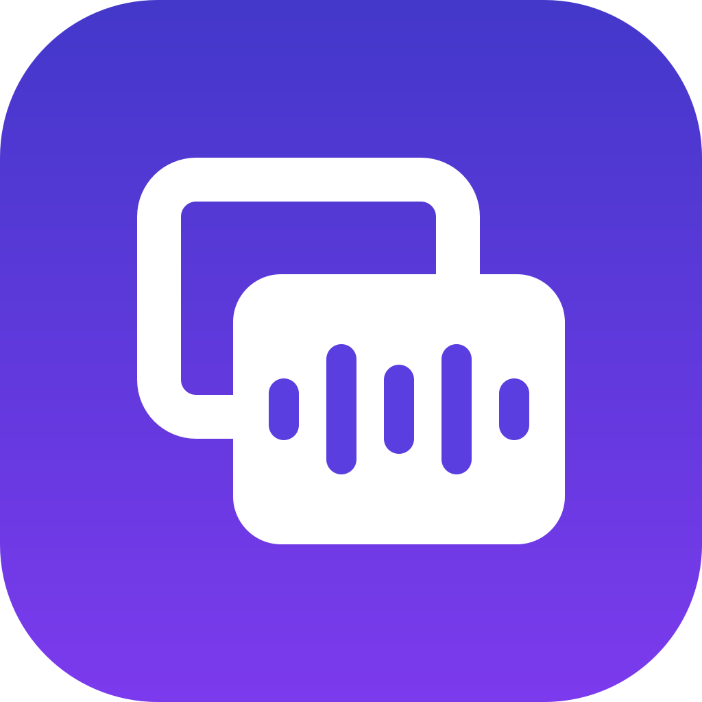

<p align="center">
  
</p>

# Overlay

**Overlay** is a private, local-first voice assistant for Windows. It does two jobs:

1. **Dictation.** Hold (or tap) a global hotkey, speak, and your words are typed into whatever app has focus. Speech-to-text runs on your own PC with Whisper (GPU-accelerated on NVIDIA cards).
2. **Ask anything.** Press a second hotkey, speak or type a question, and a small always-on-top window shows just the answer. Overlay can search the web, cite its sources, and do a few safe things on your PC ("open Spotify", "volume 30", "take a screenshot").

By default everything runs locally: Whisper for speech, and [Ollama](https://ollama.com) with `qwen3.5:4b-q4_K_M` for answers. Cloud services are optional and only used when you add their key.

> Based on OpenWhispr (MIT) by Gizmo Labs Inc. and contributors.
> Upstream: https://github.com/OpenWhispr/openwhispr (commit `1e9f243`). See `LICENSE` and `NOTICE`.

New to the code? Read [`docs/ARCHITECTURE.md`](docs/ARCHITECTURE.md) (a beginner's tour of the code).

---

## Quick start (Windows)

**Before you start, install:**

- [Node.js 24](https://nodejs.org) (`winget install OpenJS.NodeJS`)
- [Git](https://git-scm.com) (`winget install Git.Git`)
- [Ollama](https://ollama.com/download) (`winget install Ollama.Ollama`). Leave it running.

An NVIDIA GPU is optional but recommended. You need about 8 GB of free disk space for the models.

**Then copy and paste:**

```powershell
git clone https://github.com/ridhamjain28/Overlay.git
cd Overlay
npm run setup
npm start
```

You can also double-click `setup.bat` instead of running `npm run setup`.

`npm run setup` (`scripts/setup.js`) does everything once:

1. Checks you have Node.js 24 or newer.
2. Installs the packages (`npm ci`). It skips this when they are already installed.
3. Downloads the local Whisper engine (`npm run download:whisper-cpp`).
4. Builds the UI so that `npm start` works.
5. Checks that Ollama is running, and starts it if it is installed but stopped. It then pulls `qwen3.5:4b-q4_K_M` (about 3.3 GB) and the fallback `qwen3:4b-instruct` (about 2.5 GB), but only if they are missing.
6. Creates your settings files from `.env.example`: `%APPDATA%\Overlay-development\.env` (used when you run from source with `npm start` or `npm run dev`) and `%APPDATA%\Overlay\.env` (used by an installed build). Every key is left blank and commented out. An existing file is never touched.

It is safe to run again. If something needs your action, it is listed at the end. Options:

- `--skip-models`: don't check or pull models.
- `--only-default-model`: don't pull the fallback model.
- `--force-install`: reinstall the packages.
- `--skip-install`, `--skip-whisper`, `--skip-build`: skip those steps.

Pass an option like this: `npm run setup -- --skip-models`.

`npm start` launches the app. `npm run dev` starts it with hot reload, for development. The first launch also fetches a few small helper programs.

**Manual setup**, if you prefer:

```powershell
npm ci
ollama pull qwen3.5:4b-q4_K_M
ollama pull qwen3:4b-instruct
npm run download:whisper-cpp
npm run dev
```

`npm ci` also prepares the native SQLite module for Electron (`scripts/install-native-deps.js`). If no matching prebuilt exists and there are no C++ build tools, it downloads the official better-sqlite3 prebuilt for Electron 43 instead. Set `OVERLAY_SKIP_NATIVE_REBUILD=1` to skip this step.

**Windows Smart App Control.** If Smart App Control is on, Windows may block helper programs that `npm run dev` compiles on your PC, because they are unsigned. On the test laptop it blocked `resources\bin\windows-key-listener.exe` (see Event Viewer → Applications and Services Logs → Microsoft → Windows → CodeIntegrity → Operational). Without it, modifier-only hotkeys (e.g. Right Ctrl alone) and hold-to-talk don't work. Normal key combinations in tap-to-toggle mode (e.g. Ctrl+Shift+Space) are registered through Electron instead. This path wasn't tested with a real key press. The downloaded `whisper-server` was not blocked. Overlay does not change Smart App Control; decide for yourself whether to use a signed build or a different hotkey.

The first start opens a short setup: microphone permission → language → **dictation hotkey** → **assistant hotkey** → local speech model download. No account and no sign-in are needed.

### Build an installer

```powershell
npm run build:win      # unsigned Windows installer in dist/
```

Windows SmartScreen may warn about an unsigned app; that is expected for a personal build.

---

## The models

| Job                        | Default                                     | Where it runs                                       | How to get it                                             |
| -------------------------- | ------------------------------------------- | --------------------------------------------------- | --------------------------------------------------------- |
| Speech → text              | Whisper `small` (whisper.cpp)               | Your PC; NVIDIA GPU when the CUDA pack is installed | Downloaded during setup, or **Settings → Speech-to-Text** |
| Answers, cleanup, tools    | `qwen3.5:4b-q4_K_M`                         | Ollama at `http://localhost:11434/v1`               | `ollama pull qwen3.5:4b-q4_K_M`                           |
| Fallback answer model      | `qwen3:4b-instruct`                         | Ollama                                              | `ollama pull qwen3:4b-instruct`                           |
| Hinglish speech (optional) | `MSpider3/whisper-hindi2hinglish-swift-ct2` | `hinglish-asr/` server on `127.0.0.1:8765`          | `hinglish-asr\start.bat`                                  |

Overlay turns Qwen's "thinking" off (`reasoning_effort: "none"`) so answers come back fast. If `qwen3.5:4b-q4_K_M` isn't pulled but `qwen3:4b-instruct` is, Overlay switches to the fallback by itself when it starts.

**Context size** is set by Ollama, not by Overlay (Ollama's OpenAI-style API has no per-request context option). Ollama's docs say it picks the default from your VRAM, so check current behaviour there. On the RTX 5060 8 GB test laptop, `ollama ps` showed a 16384-token context and 3.4 GB of VRAM for the default model. To pin about 8k, set the environment variable `OLLAMA_CONTEXT_LENGTH=8192` for Ollama (or use the context slider in the Ollama app), then restart Ollama.

**GPU speech:** in **Settings → Speech-to-Text**, download the CUDA acceleration pack. After that Whisper uses the GPU automatically (set `WHISPER_CUDA_ENABLED=false` to force CPU). Support for the newest cards (RTX 50-series) depends on the pack and has not been verified yet; if it does not work on your card, set `WHISPER_CUDA_ENABLED=false` to use the CPU.

---

## Ways to power Overlay

You can mix and match. The **Answer source** setting (Settings → Language Models, on the chat and voice-agent tabs) picks who writes answers:

- **Auto (default):** plain chat goes to local Ollama. Questions that need the web or a PC action go to OpenClaw if it is set up and reachable. Otherwise web questions go to Gemini with Google Search (if you added a key), and finally to local Ollama, which summarises the web-search results. PC actions fall back to local Ollama's `system_action` tool.
- **Local Ollama only**, **OpenClaw gateway**, or **Gemini + Google Search**: always use that one.

The same page shows a status dot for each service and how many Ollama web searches you used today.

**Where keys go.** Never put keys in the repository. Put them in your environment, or in the `.env` file in Overlay's data folder: `%APPDATA%\Overlay-development\.env` when you run from source (`npm start` or `npm run dev`), or `%APPDATA%\Overlay\.env` for an installed build. See `.env.example` for every name. Restart Overlay after editing.

Free tiers and quotas change often. **Check current limits** on each provider's site before relying on them.

### 1. Local Ollama (default answers)

- **Setup:** install Ollama, `ollama pull qwen3.5:4b-q4_K_M`, keep Ollama running. Nothing else.
- **Pros:** private, free, works offline, supports tool calls (PC actions).
- **Cons:** a 4B model is less knowledgeable than big cloud models; it uses ~3–4 GB of VRAM while loaded.

### 2. OpenClaw gateway (optional agent)

If you run [OpenClaw](https://docs.openclaw.ai), Overlay can send web and action requests to it through its OpenAI-compatible endpoint.

- **Setup:**
  1. In your OpenClaw config, enable `gateway.http.endpoints.chatCompletions.enabled: true`, then restart the gateway. (The endpoint is off by default.)
  2. Add `OPENCLAW_TOKEN=<your gateway token>` to Overlay's `.env` (or your environment). Optional: `OPENCLAW_URL` (default `http://127.0.0.1:18789/v1/chat/completions`) and `OPENCLAW_MODEL` (default `openclaw/default`).
- Overlay streams answers (`stream: true`) and sends a stable `user` per conversation so OpenClaw keeps one session per chat.
- **Security warning:** the gateway token is a **full-access operator credential**. Anyone with it can make your OpenClaw agent do whatever its tools allow. Keep the gateway on loopback (`127.0.0.1`) only; Overlay refuses non-loopback URLs unless you set `OVERLAY_ALLOW_REMOTE_OPENCLAW=1`. Overlay never logs or stores the token in the repo.
- **Pros:** your existing agent, tools and memory. **Cons:** another service to run; powerful credential.

### 3. Gemini free key (backup answers + Google Search)

- **Setup:** create a key at https://aistudio.google.com/app/apikey and add `GEMINI_API_KEY=...` to Overlay's `.env`, or enter it where Settings asks for a Gemini key. On start Overlay moves a `.env` key into encrypted storage. Optional: `OVERLAY_GEMINI_MODEL` (default `gemini-2.5-flash`).
- Uses Gemini's `google_search` grounding, so answers come with Google results.
- **Pros:** strong answers, real Google results, free tier. **Cons:** cloud (your question leaves your PC); quota limits (check current limits).

### 4. Ollama web search (default search provider)

- **Setup:** create a key at https://ollama.com/settings/keys and add `OLLAMA_API_KEY=...` to Overlay's `.env`.
- Overlay calls `POST https://ollama.com/api/web_search` itself (up to 5 results), then gives the top results to your answer model, which summarises them. The source links are listed under the answer.
- A local counter limits Ollama searches to **20 per day** by default (`OVERLAY_OLLAMA_SEARCH_DAILY_CAP`); usage is shown in settings. Check current limits on ollama.com.
- **Pros:** one key, fast (1.4–2.4 s per search when we measured it), works with the local model. **Cons:** cloud search; free quota.

### 5. Tavily (optional search)

- **Setup:** key from https://app.tavily.com → `TAVILY_API_KEY=...`.
- **Pros:** search API built for LLMs. **Cons:** cloud; free credits are limited (check current limits).

### 6. SearxNG (self-hosted search)

- **Setup:** run your own SearxNG (for example with Docker), enable the JSON output format (`search.formats: [html, json]` in its `settings.yml`), then set `SEARXNG_URL=http://127.0.0.1:8888` (your URL).
- **Pros:** no key, no quota, private. **Cons:** you run and maintain it; result quality depends on its engines.

**Search order:** Ollama web search → Gemini Google Search → Tavily → SearxNG. If no provider is set up, Overlay says so in plain words ("add OLLAMA_API_KEY…") instead of failing silently.

### 7. Any OpenAI-compatible endpoint

In **Settings → Language Models**, choose **Self-hosted** for a tab (chat, voice agent, cleanup…) then set the base URL and model:

| Server                   | Base URL                         | Notes                         |
| ------------------------ | -------------------------------- | ----------------------------- |
| LM Studio                | `http://localhost:1234/v1`       | Start the server in LM Studio |
| llama.cpp `llama-server` | `http://localhost:8080/v1`       | `llama-server -m model.gguf`  |
| OpenRouter               | `https://openrouter.ai/api/v1`   | Needs an API key; many models |
| Groq                     | `https://api.groq.com/openai/v1` | Needs an API key; very fast   |

Local servers are private and free; hosted ones need a key and send your text to them.

### 8. Local Whisper (default speech-to-text)

- **Setup:** pick a model in setup or **Settings → Speech-to-Text** (default `small`). Add the CUDA pack for GPU speed.
- **Pros:** private, offline, good English and Hindi. **Cons:** bigger models need more memory; first download takes time.

### 9. Hinglish ASR server (optional)

For Hindi/Hinglish speech typed in **Roman script**.

- **Setup:** install Python 3.10–3.12, run `hinglish-asr\start.bat` (it creates its own `.venv`, downloads the model to your Hugging Face cache, and runs hidden). Then **Settings → Speech-to-Text → Self-hosted**, URL `http://127.0.0.1:8765/v1`. Stop with `stop.bat`. Details: [`hinglish-asr/README.md`](hinglish-asr/README.md).
- Even without this server you can choose **Hinglish (Roman script)** as the output language; Overlay then asks the language model to write Roman-script Hinglish.
- **Pros:** much better Hinglish. **Cons:** a second process using GPU memory.

---

## What the assistant can do on your PC

The `system_action` tool has a fixed allowlist. Anything else is refused.

| Action                         | Example             | Asks first?                                    |
| ------------------------------ | ------------------- | ---------------------------------------------- |
| Open an app                    | "open Notepad"      | No (built-in list + your Start-menu shortcuts) |
| Open a website                 | "open youtube.com"  | No (http/https only)                           |
| Volume up/down/mute/set        | "volume 30"         | No                                             |
| Media play/pause/next/previous | "next song"         | No                                             |
| Screen brightness              | "brightness 60"     | **Yes**                                        |
| Tell the time                  | "what time is it"   | No                                             |
| Screenshot                     | "take a screenshot" | **Yes**                                        |
| Lock the PC                    | "lock my PC"        | **Yes**                                        |

There is no shell access, no shutdown/restart, and no file deletion. Risky actions show an on-screen confirmation that you must click.

---

## Privacy

- No account, no telemetry, no automatic updates (set `OVERLAY_ENABLE_UPDATES=1` to allow update checks against this repo's releases).
- There are no accounts, hosted transcription, cloud sync or billing; Overlay runs on this PC with your own keys.
- Cloud providers (Gemini, Tavily, Ollama web search, OpenRouter, Groq) only see your question when you have added their key and a request needs them.

## Development

```powershell
npm run dev            # Vite + Electron with hot reload
npm test               # unit tests (node --test)
npm run typecheck      # TypeScript
npm run lint
```

Overlay-specific code lives in `src/helpers/overlay/`, `src/services/overlay/`, `src/services/tools/systemActionTool.ts`, `src/components/settings/AnswerSourceSettings.tsx` and `test/overlay/`.

## License

MIT. Copyright (c) the OpenWhispr authors (Gizmo Labs Inc. and contributors) and (c) 2026 Ridham Jain for the Overlay changes. See `LICENSE` and `NOTICE`.
